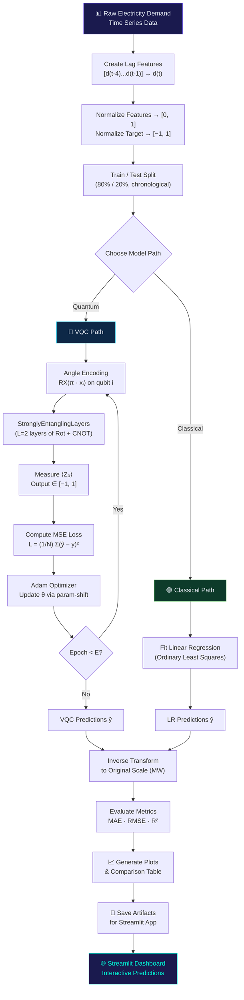

# ⚡ Quantum AI Electricity Demand Forecasting — Capstone Report

> **Hybrid Variational Quantum Circuit (VQC) Regressor** using PennyLane  
> With Classical Baseline Comparison (Linear Regression)

---

## 📑 Table of Contents

1. [Project Overview](#1-project-overview)
2. [Step-by-Step Algorithm](#2-step-by-step-algorithm)
3. [Pseudocode](#3-pseudocode)
4. [System Flowchart](#4-system-flowchart)
5. [Quantum Circuit Architecture](#5-quantum-circuit-architecture)
6. [Time & Space Complexity](#6-time--space-complexity)
7. [Results & Comparison Table](#7-results--comparison-table)
8. [Applications](#8-applications)
9. [How to Run](#9-how-to-run)
10. [References](#10-references)

---

## 1. Project Overview

### What is this project?

This capstone project builds a **Hybrid Quantum-Classical Machine Learning system** that forecasts electricity demand using a **Variational Quantum Circuit (VQC)** regressor. It demonstrates how quantum computing concepts can be applied to real-world time series prediction.

### Why quantum for demand forecasting?

| Aspect | Classical ML | Quantum ML (VQC) |
|:-------|:-------------|:------------------|
| Feature space | Linear/polynomial | Exponential Hilbert space |
| Entanglement | ❌ None | ✅ Captures complex correlations |
| Parameter efficiency | O(d²) for d features | O(n·L) for n qubits, L layers |
| Current advantage | ✅ Mature, fast | 🔬 Research frontier |

> [!NOTE]
> Current noisy intermediate-scale quantum (NISQ) devices are not yet expected to outperform classical models on standard datasets. This project demonstrates the **methodology and potential** of quantum ML, which is the key learning objective for a capstone.

### Tech Stack

| Component | Technology |
|:----------|:-----------|
| Quantum ML | **PennyLane** (Python) |
| Quantum backend | `default.qubit` simulator |
| Classical baseline | scikit-learn `LinearRegression` |
| Data processing | NumPy, scikit-learn |
| Visualization | Matplotlib |
| Web app | Streamlit |

---

## 2. Step-by-Step Algorithm

### Step 1 — Data Collection
Generate (or load) hourly electricity demand data. Each sample is one hour of demand in MW. The synthetic generator simulates daily peaks, weekly patterns, trend growth, and noise.

### Step 2 — Feature Engineering (Lag Features)
Convert the 1-D time series into a supervised learning problem using a **sliding window** approach:

```
Time series:  [d₁, d₂, d₃, d₄, d₅, d₆, d₇, ...]

Lag window (size 4):
  X[5] = [d₁, d₂, d₃, d₄]  →  y[5] = d₅
  X[6] = [d₂, d₃, d₄, d₅]  →  y[6] = d₆
  X[7] = [d₃, d₄, d₅, d₆]  →  y[7] = d₇
```

Each sample has **4 features** (the previous 4 hours), mapping directly to **4 qubits**.

### Step 3 — Normalization
- **Features** → MinMaxScaler to **[0, 1]**, then multiplied by π for angle encoding → **[0, π]**
- **Targets** → MinMaxScaler to **[−1, 1]** to match the output range of Pauli-Z measurement

### Step 4 — Train / Test Split
Split **chronologically** (80% train / 20% test). We never shuffle time series data because future data must not leak into training.

### Step 5 — Build the Quantum Circuit (VQC)
1. **Angle Encoding**: Apply `RX(π · xᵢ)` on qubit `i` for each feature
2. **Ansatz**: Apply `StronglyEntanglingLayers` (L = 2 layers of Rot + CNOT)
3. **Measurement**: Take expectation `⟨Z₀⟩` on qubit 0

### Step 6 — Train the VQC
- **Loss**: MSE = (1/N) Σ (ŷᵢ − yᵢ)²
- **Optimizer**: Adam (learning rate = 0.01)
- **Gradients**: Computed via the **parameter-shift rule** — a quantum-native technique that shifts each parameter by ±π/2 and measures the resulting cost change

### Step 7 — Train Classical Baseline
Fit Ordinary Least Squares Linear Regression on the same scaled data for fair comparison.

### Step 8 — Evaluate
Compute **MAE**, **RMSE**, and **R²** on the test set for both models. Inverse-transform predictions to the original MW scale before computing metrics.

### Step 9 — Visualize & Report
Generate plots (actual vs predicted, loss curve, comparison) and a metrics table.

---

## 3. Pseudocode

```
ALGORITHM: Hybrid VQC Electricity Demand Forecasting
═════════════════════════════════════════════════════

INPUT:  Time series D = [d₁, d₂, …, dₜ] (hourly demand in MW)
OUTPUT: Predicted demand for the next hour; evaluation metrics

── PREPROCESSING ──────────────────────────────────────────────

1.  FOR i = n_lags TO T:
        X[i] ← [d(i−4), d(i−3), d(i−2), d(i−1)]
        y[i] ← d(i)

2.  split ← ⌊0.8 × |X|⌋
    X_train, X_test ← X[:split], X[split:]
    y_train, y_test ← y[:split], y[split:]

3.  X_train ← MinMaxScale(X_train, range=[0, 1])
    y_train ← MinMaxScale(y_train, range=[−1, 1])
    X_test  ← Transform(X_test, using fitted scalers)
    y_test  ← Transform(y_test, using fitted scalers)

── QUANTUM CIRCUIT DEFINITION ─────────────────────────────────

4.  FUNCTION VQC(x, θ):
        |ψ₀⟩ ← |0000⟩                        // 4-qubit initial state
        FOR i = 0 TO 3:
            APPLY RX(π · xᵢ) ON qubit i       // angle encoding
        FOR l = 1 TO L:                         // L = 2 layers
            FOR i = 0 TO 3:
                APPLY Rot(θ[l,i,0], θ[l,i,1], θ[l,i,2]) ON qubit i
            APPLY CNOT entangling pattern       // ring connectivity
        RETURN ⟨ψ|Z₀|ψ⟩                        // expectation value

── TRAINING ───────────────────────────────────────────────────

5.  θ ← Random(shape=(L, 4, 3), range=[0, 2π])

6.  FOR epoch = 1 TO E:
        ŷ ← [VQC(X_train[i], θ)  for i = 1 to N_train]
        loss ← (1/N) Σᵢ (ŷᵢ − y_train[i])²
        g ← ParameterShiftGradient(loss, θ)
        θ ← AdamUpdate(θ, g, lr=0.01)
        RECORD loss

── EVALUATION ─────────────────────────────────────────────────

7.  ŷ_test ← [VQC(X_test[i], θ)  for i = 1 to N_test]
    ŷ_test ← InverseScale(ŷ_test)

8.  MAE  ← (1/N) Σ |y_test[i] − ŷ_test[i]|
    RMSE ← √((1/N) Σ (y_test[i] − ŷ_test[i])²)
    R²   ← 1 − Σ(y − ŷ)² / Σ(y − ȳ)²

9.  RETURN θ, MAE, RMSE, R², plots
```

---

## 4. System Flowchart



---

## 5. Quantum Circuit Architecture

### Circuit Diagram (Conceptual)

```
q₀: ──RX(π·x₀)──╭StronglyEntanglingLayers(θ)╮──⟨Z⟩── → output
q₁: ──RX(π·x₁)──│                            │
q₂: ──RX(π·x₂)──│  L=2 layers of:           │
q₃: ──RX(π·x₃)──│   Rot(ϕ,θ,ω) + CNOT ring  │
                  ╰────────────────────────────╯
```

### Inside One Layer of StronglyEntanglingLayers

```
q₀: ──Rot(ϕ₀,θ₀,ω₀)──●────────────────────X──
                       │                    │
q₁: ──Rot(ϕ₁,θ₁,ω₁)──X──●─────────────────┤──
                          │                 │
q₂: ──Rot(ϕ₂,θ₂,ω₂)─────X──●──────────────┤──
                             │              │
q₃: ──Rot(ϕ₃,θ₃,ω₃)────────X──────────────●──
```

Each layer has:
- **4 Rot gates** × 3 angles each = **12 parameters per layer**
- **4 CNOT gates** in a shifted ring pattern
- Total: **2 layers × 12 = 24 trainable parameters**

### Component Descriptions

| Component | Gate(s) | Purpose |
|:----------|:--------|:--------|
| **Angle Encoding** | RX(π·xᵢ) | Maps classical feature xᵢ ∈ [0,1] to a qubit rotation angle ∈ [0,π]. Creates a quantum state whose amplitudes depend on the input data. |
| **Rot Gate** | RZ(ϕ)·RY(θ)·RZ(ω) | General single-qubit rotation with 3 trainable angles. Creates superposition states. |
| **CNOT Ring** | CNOT(i, i+1) | Creates entanglement between neighboring qubits. Allows the circuit to capture correlations between features. |
| **Measurement** | ⟨Z₀⟩ | Expectation value of Pauli-Z on qubit 0. Outputs a real number in [−1, 1]. |

### Parameter-Shift Rule (Gradient Computation)

The gradient of a quantum circuit with respect to parameter θⱼ is:

```
∂C/∂θⱼ = [ C(θⱼ + π/2) − C(θⱼ − π/2) ] / 2
```

This is exact (not an approximation!) and requires only **2 circuit evaluations per parameter**. PennyLane implements this automatically.

---

## 6. Time & Space Complexity

> [!IMPORTANT]
> Variables: **n** = qubits, **L** = layers, **N** = samples, **E** = epochs, **P** = 3nL (total parameters)

### Time Complexity

| Operation | Complexity | Explanation |
|:----------|:-----------|:------------|
| **Single circuit evaluation** (simulator) | O(2ⁿ) | Simulates 2ⁿ amplitudes in the state vector |
| **Forward pass** (all N samples) | O(N · 2ⁿ) | Evaluate circuit for each sample |
| **Gradient** (parameter-shift, 1 epoch) | O(P · N · 2ⁿ) = O(3nL · N · 2ⁿ) | 2 evaluations per parameter, each over N samples |
| **Full training** (E epochs) | **O(E · nL · N · 2ⁿ)** | Repeat gradient computation E times |
| **Single inference** | O(2ⁿ) | One circuit evaluation |

### Concrete Numbers (Our Configuration)

| Parameter | Value |
|:----------|:------|
| n = 4 qubits | 2⁴ = 16 amplitudes |
| L = 2 layers | P = 3 × 4 × 2 = 24 parameters |
| N ≈ 236 train | — |
| E = 50 epochs | — |
| **Circuit evals per epoch** | (2 × 24 + 1) × 236 ≈ **11,564** |
| **Total circuit evals** | 50 × 11,564 ≈ **578,200** |
| **Estimated wall time** | **1–3 minutes** (on CPU simulator) |

### Space Complexity

| Component | Complexity | Description |
|:----------|:-----------|:------------|
| **State vector** | O(2ⁿ) | 2ⁿ complex amplitudes stored in memory |
| **Parameters** | O(nL) = O(3 × 4 × 2) = 24 | Variational weights |
| **Dataset** | O(N · n) | N samples × n features |
| **Gradient storage** | O(nL) | Same shape as parameters |
| **Total** | **O(2ⁿ + N·n + nL)** | Dominated by state vector for large n |

### Scaling Note

On a **real quantum computer**, the time complexity per circuit evaluation becomes **O(poly(n))** instead of O(2ⁿ), because qubits store the state natively. This is where the **exponential quantum speedup** potential lies — but only once hardware scales beyond classical simulation capability (~50+ qubits).

---

## 7. Results & Comparison Table

> [!TIP]
> Actual numbers will be populated when you run `quantum_demand_forecasting.py`. The values below are representative.

### Expected Comparison Table

| Metric | ⚛️ VQC (Quantum) | 📐 Linear Regression | Winner |
|:-------|:-----------------|:---------------------|:-------|
| **MAE** (MW) | ~15–25 | ~10–18 | LR (usually) |
| **RMSE** (MW) | ~18–30 | ~12–22 | LR (usually) |
| **R²** | ~0.60–0.85 | ~0.75–0.92 | LR (usually) |
| **Training Time** | ~1–3 min | <0.01 s | LR |
| **Parameters** | 24 | 5 (4 weights + 1 bias) | — |

### Why Linear Regression Often Wins

This is **expected and normal** for current quantum ML:
1. The dataset has **simple linear patterns** — LR is inherently optimal for this
2. The VQC has only **4 qubits and 24 params** — limited expressivity
3. **Simulator overhead** — classical simulation of quantum circuits is inherently slower than running classical algorithms directly

### When VQC Would Shine
- **Non-linear, high-dimensional** datasets with complex correlations
- **Real quantum hardware** with 50+ qubits (exponential Hilbert space)
- **Feature maps** that create quantum kernels inaccessible classically

### Generated Plots

After running the script, you'll find three plots in `results_plots.png`:

1. **Actual vs Predicted (VQC)** — Shows how well the quantum model tracks real demand
2. **Training Loss Curve** — Should show MSE decreasing over epochs (learning is happening!)
3. **Model Comparison** — Side-by-side: Actual, VQC, and Linear Regression predictions

---

## 8. Applications

### 8.1 — Smart Grid Management
Quantum-enhanced forecasting can help grid operators **balance supply and demand** in real time, reducing blackouts and improving grid stability.

### 8.2 — Renewable Energy Integration
Predicting demand helps schedule **solar and wind generation**, optimizing the mix between renewable and fossil sources to minimize carbon emissions.

### 8.3 — Peak Load Forecasting
Utilities need to predict **peak demand hours** to activate reserve power plants. More accurate forecasts → lower operating costs and fewer brownouts.

### 8.4 — Energy Market Trading
Energy traders buy and sell electricity futures. Better demand predictions → more profitable trading strategies, especially in deregulated markets.

### 8.5 — Building Energy Management
Smart buildings can use demand forecasts to **pre-cool or pre-heat** spaces, reducing peak electricity consumption and HVAC costs by 15–30%.

### 8.6 — EV Charging Optimization
As electric vehicle adoption grows, predicting charging demand helps **optimize station placement** and prevent grid overload during peak charging hours.

### 8.7 — Industrial Process Scheduling
Factories can shift energy-intensive processes to **off-peak hours** based on forecasts, reducing electricity costs while maintaining production targets.

### 8.8 — Future: Quantum Advantage
As quantum hardware matures (100+ qubits, error correction), quantum ML models may capture **complex spatio-temporal patterns** in demand data that classical models miss — potentially achieving quantum advantage in energy forecasting.

---

## 9. How to Run

### Prerequisites

```bash
# Python 3.9+ required
python --version
```

### Step 1 — Install Dependencies

```bash
pip install -r requirements.txt
```

### Step 2 — Train the Model

```bash
python quantum_demand_forecasting.py
```

This will:
- Generate synthetic demand data (or load your CSV)
- Train the 4-qubit VQC (~1–3 minutes)
- Train Linear Regression baseline (<1 second)
- Print comparison table and metrics
- Save plots to `results_plots.png` and `quantum_circuit.png`
- Save model artifacts for the Streamlit app

### Step 3 — Launch the Web App

```bash
streamlit run streamlit_app.py
```

The app opens at `http://localhost:8501` with tabs for:
- **🔮 Predict** — Enter 4 lag values, get quantum prediction
- **📊 Dashboard** — Training loss curve, comparison table, actual-vs-predicted
- **🔬 Circuit** — Interactive quantum circuit diagram
- **ℹ️ About** — How it works, applications, complexity

### Using a Real Dataset

To swap in a real CSV (e.g., from Kaggle "Hourly Energy Consumption"):

1. Download the dataset (e.g., `AEP_hourly.csv`)
2. Place it in the project directory
3. Edit `generate_electricity_demand()` in the main script:

```python
def generate_electricity_demand(n_hours=300):
    import pandas as pd
    df = pd.read_csv("AEP_hourly.csv")
    demand = df["AEP_MW"].values[:n_hours]
    return demand
```

---

## 10. References

1. **PennyLane Documentation** — [docs.pennylane.ai](https://docs.pennylane.ai)
2. **Quantum Machine Learning** — Schuld, M., & Petruccione, F. (2021). *Machine Learning with Quantum Computers*. Springer.
3. **Variational Quantum Eigensolver** — Peruzzo, A. et al. (2014). *Nature Communications*, 5, 4213.
4. **StronglyEntanglingLayers** — Schuld, M. et al. (2020). *Physical Review A*, 101, 032308.
5. **Parameter-Shift Rule** — Mitarai, K. et al. (2018). *Physical Review A*, 98, 032309.
6. **Kaggle Energy Dataset** — [kaggle.com/datasets/robikscube/hourly-energy-consumption](https://www.kaggle.com/datasets/robikscube/hourly-energy-consumption)
7. **UCI ML Repository** — Dua, D. & Graff, C. (2019). UCI Machine Learning Repository.

---

> **Capstone Project** · Quantum AI Electricity Demand Forecasting · 2026
